<picture>
  <source media="(prefers-color-scheme: dark)" srcset="https://raw.githubusercontent.com/RevenueCat/.github/main/profile/how-it-works-dark.svg">
  
</picture>

# RevenueCat

Build, analyze, and grow in-app subscriptions. Add the SDK, configure your products, and RevenueCat handles purchases, entitlements, and subscription state across iOS, Android, and the web.

New to RevenueCat? [Create a free account](https://app.revenuecat.com/signup) and follow the quickstart.

[Docs](https://www.revenuecat.com/docs?utm_source=github&utm_medium=org_readme) ·
[Quickstart](https://www.revenuecat.com/docs/getting-started/quickstart?utm_source=github&utm_medium=org_readme) ·
[API Reference](https://www.revenuecat.com/docs/api-v2?utm_source=github&utm_medium=org_readme) ·
[Dashboard](https://app.revenuecat.com/) ·
[Changelog](https://www.revenuecat.com/changelog?utm_source=github&utm_medium=org_readme)

 

## SDKs

Pick your platform on the [docs homepage](https://www.revenuecat.com/docs?utm_source=github&utm_medium=org_readme), or go straight to the repo. Each repo includes a sample app. Class and method references are listed in the [SDK reference](https://www.revenuecat.com/docs/platform-resources/sdk-reference?utm_source=github&utm_medium=org_readme).

| Platform | Repo |
|---|---|
| iOS, macOS, watchOS, tvOS, visionOS | [purchases-ios](https://github.com/RevenueCat/purchases-ios) |
| Android | [purchases-android](https://github.com/RevenueCat/purchases-android) |
| Flutter | [purchases-flutter](https://github.com/RevenueCat/purchases-flutter) |
| React Native | [react-native-purchases](https://github.com/RevenueCat/react-native-purchases) |
| Kotlin Multiplatform | [purchases-kmp](https://github.com/RevenueCat/purchases-kmp) |
| Unity | [purchases-unity](https://github.com/RevenueCat/purchases-unity) |
| Capacitor | [purchases-capacitor](https://github.com/RevenueCat/purchases-capacitor) |
| Cordova | [cordova-plugin-purchases](https://github.com/RevenueCat/cordova-plugin-purchases) |
| Web | [purchases-js](https://github.com/RevenueCat/purchases-js) |

## Build with AI agents

Set up RevenueCat and integrate the SDK from Claude Code, Cursor, Codex, or Gemini CLI.

| Tool | What it does |
|---|---|
| [AI Toolkit](https://github.com/RevenueCat/ai-toolkit) | Plugin that installs RevenueCat skills and the MCP server in one step. [Docs](https://www.revenuecat.com/docs/tools/ai-toolkit?utm_source=github&utm_medium=org_readme) |
| [MCP server](https://www.revenuecat.com/docs/tools/mcp?utm_source=github&utm_medium=org_readme) | Connects your agent to your RevenueCat projects to manage products, read charts, and check configuration. |
| [CLI](https://github.com/RevenueCat/cli) | The `rc` command manages projects, products, customers, and subscriptions from your terminal. Every command supports `--json`. [Docs](https://www.revenuecat.com/docs/tools/cli?utm_source=github&utm_medium=org_readme) |
| [play-billing-skills](https://github.com/RevenueCat/play-billing-skills) | Skills for integrating Google Play Billing and the RevenueCat SDK on Android. |

Pointing an agent at the docs? Use [llms.txt](https://www.revenuecat.com/docs/llms.txt). Every docs page also has a Markdown version.

## Get help

- Search the [docs](https://www.revenuecat.com/docs?utm_source=github&utm_medium=org_readme)
- SDK bug or feature request: open an issue in the SDK repo
- Account or billing problem: contact [RevenueCat Support](https://www.revenuecat.com/docs/revenuecat-support/support-first-steps?utm_source=github&utm_medium=org_readme)
- Questions and discussion: [RevenueCat Community](https://community.revenuecat.com/)

## Contribute

Each repo has its own contributing guide. To report a security issue, see the [vulnerability disclosure program](https://www.revenuecat.com/docs/welcome/set-up-revenuecat/hackerone).
